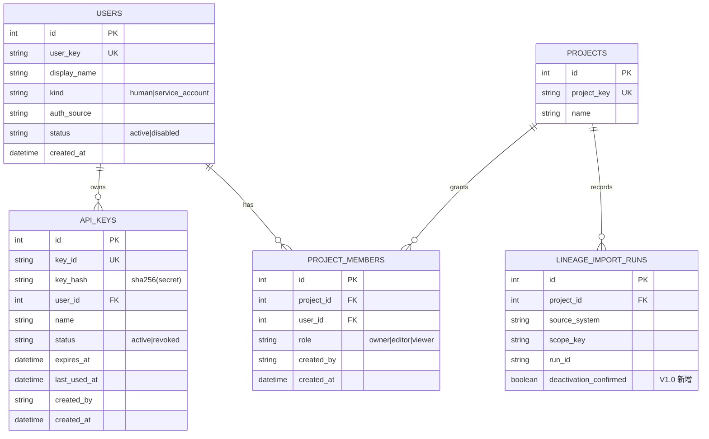

# V1.0 ERD 与表变更说明

> 配套文档：《数据建模中心_V1.0_需求说明书.md》第 5 章。基线：V0.9.2（15 张表，revision `b5f2c4a9d703`）；V1.0 后 18 张表。所有时间字段统一存 UTC（与 `backend/app/models.py:20` 一致）。

## 1. 变更总览

| 变更 | 对象 | 性质 |
| --- | --- | --- |
| 新增表 | `users` | 认证主体（人/服务账号） |
| 新增表 | `api_keys` | API Key 凭据（只存哈希） |
| 新增表 | `project_members` | 项目级角色授权 |
| 新增列 | `lineage_import_runs.deactivation_confirmed` | full_snapshot 停用确认标志（BOOLEAN NOT NULL DEFAULT false） |
| 既有表 | 其余 14 张 | 不改列、不重建 |

迁移：单 revision（实际 `7f0c38e854e5`，down_revision=`b5f2c4a9d703`）。downgrade 删除三张新表并移除新列（密钥不可恢复，见升级指南第 6 节）。

## 2. 新增表定义

### 2.1 users（认证主体）

| 字段 | 类型 | 约束 | 说明 |
| --- | --- | --- | --- |
| id | Integer | PK | 内部主键 |
| user_key | String(80) | UNIQUE, NOT NULL | 主体键；模式 `^[a-z]+:[A-Za-z0-9_.-]{1,64}$`，如 `u:alice`、`sa:dbt-importer` |
| display_name | String(160) | NOT NULL | 展示名 |
| kind | String(24) | NOT NULL, CHECK IN ('human','service_account') | 人与服务账号 |
| auth_source | String(24) | NOT NULL, DEFAULT 'local' | 认证来源；local/api_key；为 OIDC 预留 |
| status | String(24) | NOT NULL, DEFAULT 'active', CHECK IN ('active','disabled') | 禁用后全部密钥失效 |
| created_at | DateTime(timezone=True) | NOT NULL, DEFAULT utcnow | 创建时间 |

### 2.2 api_keys（凭据）

| 字段 | 类型 | 约束 | 说明 |
| --- | --- | --- | --- |
| id | Integer | PK | 内部主键 |
| key_id | String(40) | UNIQUE, NOT NULL | 公开 ID（`ak_` + 10-40 位字母数字，不含下划线） |
| key_hash | String(64) | NOT NULL | `SHA-256(secret)` 十六进制；`hmac.compare_digest` 比较 |
| user_id | Integer | FK → users.id ON DELETE CASCADE, NOT NULL | 归属主体 |
| name | String(80) | NOT NULL | 用途备注 |
| status | String(24) | NOT NULL, DEFAULT 'active', CHECK IN ('active','revoked') | 吊销状态 |
| expires_at | DateTime(timezone=True) | NULL | 过期时间；NULL 不过期 |
| last_used_at | DateTime(timezone=True) | NULL | 最近使用（≥60s 节流更新） |
| created_by | String(80) | NOT NULL | 创建者 |
| created_at | DateTime(timezone=True) | NOT NULL | 创建时间 |

索引：`ix_api_key_user(user_id)`；`ix_api_key_hash(key_hash)`。

令牌格式：`Authorization: Bearer dmc_<key_id>_<secret>`；secret 为 256 位随机数 base64url，仅创建响应返回一次。

### 2.3 project_members（项目授权）

| 字段 | 类型 | 约束 | 说明 |
| --- | --- | --- | --- |
| id | Integer | PK | 内部主键 |
| project_id | Integer | FK → projects.id ON DELETE CASCADE, NOT NULL | 项目 |
| user_id | Integer | FK → users.id ON DELETE CASCADE, NOT NULL | 成员主体 |
| role | String(24) | NOT NULL, CHECK IN ('owner','editor','viewer') | 角色 |
| created_by | String(80) | NOT NULL | 操作者 |
| created_at | DateTime(timezone=True) | NOT NULL | 授权时间 |

约束：`UNIQUE(project_id, user_id)`（幂等 upsert）；索引 `ix_project_member_project(project_id)`。

### 2.4 lineage_import_runs（变更）

在既有表（`backend/app/models.py:484-543`）上新增：

| 字段 | 类型 | 约束 | 说明 |
| --- | --- | --- | --- |
| deactivation_confirmed | Boolean | NOT NULL, DEFAULT false（server_default） | full_snapshot 停用确认标志；既有行回填 false |

## 3. ERD（Mermaid）



与 V0.9.2 既有表的关系（不变）：`projects` 1—* `data_models`/`model_versions`/`project_graph_snapshots`/`external_lineage_edges`/`lineage_import_runs`/`activity_events` 等，见 `docs/核心元数据关系图.png` 与 `docs/v0.9/数据建模中心_V0.9.2_Scope身份关系图.png`。

## 4. 迁移 SQL 草案（Alembic upgrade，实际 revision 7f0c38e854e5）

```python
def upgrade() -> None:
    op.create_table(
        "users",
        sa.Column("id", sa.Integer(), nullable=False),
        sa.Column("user_key", sa.String(length=80), nullable=False),
        sa.Column("display_name", sa.String(length=160), nullable=False),
        sa.Column("kind", sa.String(length=24), nullable=False),
        sa.Column("auth_source", sa.String(length=24), nullable=False, server_default="local"),
        sa.Column("status", sa.String(length=24), nullable=False, server_default="active"),
        sa.Column("created_at", sa.DateTime(timezone=True), nullable=False),
        sa.PrimaryKeyConstraint("id"),
        sa.UniqueConstraint("user_key", name="uq_user_key"),
        sa.CheckConstraint("kind IN ('human','service_account')", name="ck_user_kind"),
        sa.CheckConstraint("status IN ('active','disabled')", name="ck_user_status"),
    )
    op.create_table(
        "api_keys",
        sa.Column("id", sa.Integer(), nullable=False),
        sa.Column("key_id", sa.String(length=40), nullable=False),
        sa.Column("key_hash", sa.String(length=64), nullable=False),
        sa.Column("user_id", sa.Integer(), nullable=False),
        sa.Column("name", sa.String(length=80), nullable=False),
        sa.Column("status", sa.String(length=24), nullable=False, server_default="active"),
        sa.Column("expires_at", sa.DateTime(timezone=True), nullable=True),
        sa.Column("last_used_at", sa.DateTime(timezone=True), nullable=True),
        sa.Column("created_by", sa.String(length=80), nullable=False),
        sa.Column("created_at", sa.DateTime(timezone=True), nullable=False),
        sa.PrimaryKeyConstraint("id"),
        sa.ForeignKeyConstraint(["user_id"], ["users.id"], ondelete="CASCADE"),
        sa.UniqueConstraint("key_id", name="uq_api_key_id"),
        sa.CheckConstraint("status IN ('active','revoked')", name="ck_api_key_status"),
    )
    op.create_index("ix_api_key_user", "api_keys", ["user_id"])
    op.create_index("ix_api_key_hash", "api_keys", ["key_hash"])
    op.create_table(
        "project_members",
        sa.Column("id", sa.Integer(), nullable=False),
        sa.Column("project_id", sa.Integer(), nullable=False),
        sa.Column("user_id", sa.Integer(), nullable=False),
        sa.Column("role", sa.String(length=24), nullable=False),
        sa.Column("created_by", sa.String(length=80), nullable=False),
        sa.Column("created_at", sa.DateTime(timezone=True), nullable=False),
        sa.PrimaryKeyConstraint("id"),
        sa.ForeignKeyConstraint(["project_id"], ["projects.id"], ondelete="CASCADE"),
        sa.ForeignKeyConstraint(["user_id"], ["users.id"], ondelete="CASCADE"),
        sa.UniqueConstraint("project_id", "user_id", name="uq_project_member"),
        sa.CheckConstraint("role IN ('owner','editor','viewer')", name="ck_member_role"),
    )
    op.create_index("ix_project_member_project", "project_members", ["project_id"])
    op.add_column(
        "lineage_import_runs",
        sa.Column("deactivation_confirmed", sa.Boolean(), nullable=False, server_default=sa.false()),
    )


def downgrade() -> None:
    op.drop_column("lineage_import_runs", "deactivation_confirmed")  # SQLite: batch 模式
    op.drop_table("project_members")
    op.drop_table("api_keys")
    op.drop_table("users")
```

实现注意（与既有迁移一致）：

- SQLite 的 `drop_column` 走 batch 模式（参考 `migrations/versions/b5f2c4a9d703_scope_aware_identity.py` 的 `render_as_batch` 用法）。
- 服务端 `server_default=sa.false()` 保证既有行回填；`alembic check` 必须无差异。
- downgrade 前提示导出成员/密钥台账（升级指南第 6 节）；不得 stamp 绕过。

## 5. 种子与引导数据

- demo 模式启动（`AUTH_MODE=demo`，默认）：幂等插入 `u:demo.admin`（human，admin）与每个既有项目的 owner 成员记录（`seed.py` 增量，不影响业务种子）。
- api_key 模式：不自动生成任何密钥；`POST /api/auth/bootstrap` 在 `users` 为空时创建首个管理员（`BOOTSTRAP_TOKEN` 保护，一次性）。
